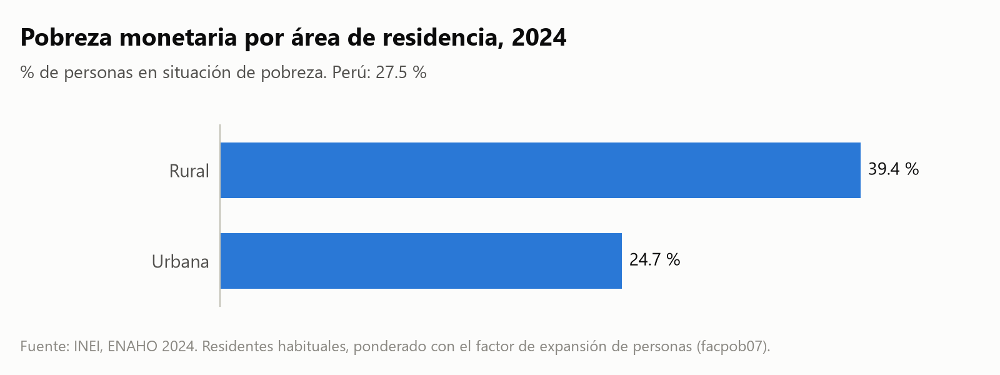
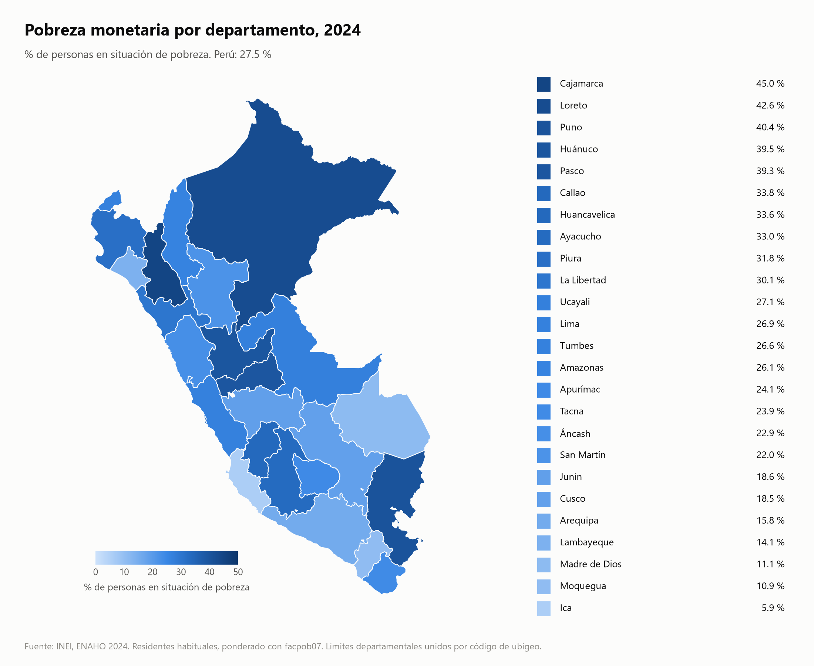

# Skills ENAHO

Cuatro skills de Claude Code que descargan, limpian, grafican y mapean la ENAHO del INEI, siempre de la misma forma. La limpieza se valida replicando la pobreza monetaria oficial: **27.58 % en 2024** (INEI: 27.6 %) y **29.05 % en 2023** (INEI: 29.0 %).

| Skill | Qué hace | Sale |
|---|---|---|
| `descargando-enaho` | Baja los módulos 34 (sumaria) y 02 (miembros) del portal de microdatos del INEI | `datos/<código>-Modulo34/`, `datos/<código>-Modulo02/` |
| `limpiando-enaho` | Une personas y hogares, filtra residentes habituales y valida contra la cifra oficial | `salidas/personas_<año>.parquet`, `salidas/validacion_<año>.txt` |
| `graficando-enaho` | Barras de pobreza por área, sexo, edad, departamento o dominio | `figuras/*.png` + `.csv` |
| `mapeando-enaho` | Mapa de pobreza por departamento, unido por código de ubigeo | `mapas/*.png` + `.csv` |

Se encadenan solas: si a una le falta lo que produce la anterior, la usa primero.

```
descargando-enaho → limpiando-enaho → graficando-enaho
                                    → mapeando-enaho
```

## Requisitos

- [Claude Code](https://claude.com/claude-code)
- [uv](https://docs.astral.sh/uv/). Cada script declara sus dependencias en su cabecera (PEP 723) y `uv run` las instala solo; no hace falta crear un entorno.

`uv.toml` activa `system-certs = true` para que uv use los certificados del sistema. Hace falta en equipos donde un antivirus o un proxy inspecciona HTTPS; en los demás no cambia nada.

## Uso

Abre Claude Code en esta carpeta y pide lo que necesites; cada skill se activa por su descripción:

```
¿Cuál fue la pobreza en Cusco en 2024?
Grafica la pobreza urbana y rural
Haz un mapa de la pobreza por departamento con la ENAHO 2022
```

O llámalas con `/`:

```
/descargando-enaho 2023
/limpiando-enaho 2023
/graficando-enaho edad 2024
/mapeando-enaho 2024
```

Los scripts también corren sin Claude:

```
uv run .claude/skills/descargando-enaho/scripts/descargar.py --anio 2024
uv run .claude/skills/limpiando-enaho/scripts/limpiar.py --anio 2024
uv run .claude/skills/graficando-enaho/scripts/graficar.py --por area --anio 2024
uv run .claude/skills/mapeando-enaho/scripts/mapear.py --anio 2024
```

## Datos

`datos/` y las bases `salidas/*.parquet` no están en el repositorio: se generan con las skills. Códigos del INEI verificados: 2019 = 687 · 2020 = 737 · 2021 = 759 · 2022 = 784 · 2023 = 906 · 2024 = 966 · 2025 = 1031. Para otros años, `descargar.py` consulta el portal.

Las decisiones de limpieza (llaves como texto, residentes habituales, unión `m:1`, ponderación con `facpob07`) y las seis trampas de la ENAHO están en [`limpiando-enaho/reference.md`](.claude/skills/limpiando-enaho/reference.md).

## Resultados 2024





| Prueba | Resultado |
|---|---|
| Residentes habituales | 108,664 de 117,721 filas del módulo 200 |
| Pobreza monetaria | 27.58 % con la sumaria · 27.53 % con la base de personas |
| Pobreza extrema | 5.50 % |
| Departamentos con dato | 25 de 25 |
| Cusco | 18.5 % |
| Más y menos pobres | Cajamarca 45.0 % · Ica 5.9 % |

## Origen

Proyecto de la sesión «Skills: Claude limpia la ENAHO» del curso de ciencia de datos con Python ([d2cml-ai/Data-Science-Python](https://github.com/d2cml-ai/Data-Science-Python/tree/main/sessions/16-skills-enaho)). `slides/` guarda una copia de las diapositivas. Fuente de los datos: INEI, Encuesta Nacional de Hogares.
